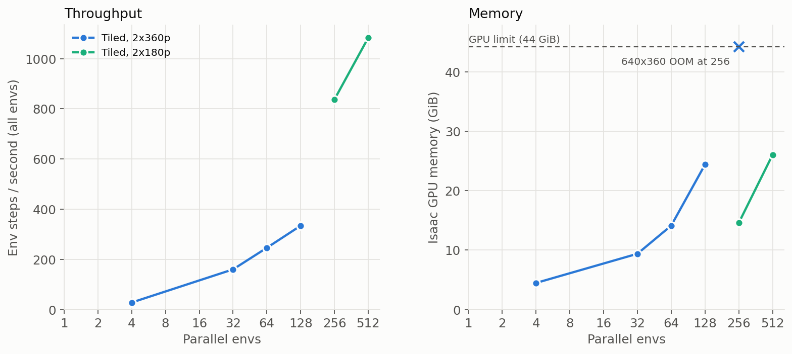

# Parallel-env benchmark (BananaBin, sim-evals env) — `scripts/bench_envs.py`

Why: the original trainer used one env and one chunk at a time (~0.86 chunks/s on BananaBin, single-env `step_ms` ~145). This measured how many parallel envs fit on one GPU. Outcome: tiled cameras, now used by
`make_parallel_env` (`environments/simeval_parallel.py`) for the trainer and `run_pi_parallel.py` (see `../current/steering_training.md`).

Measures GPU memory + env throughput vs `num_envs` with hold-pose actions (no policy server, no training loop).
One process per N (`--num-envs N [--drop-cam2] [--cam-scale 0.5]`); prints a `BENCH {json}` line. Isaac hangs at exit and
on renderer errors: the script ends with `os._exit(0)`, and when sweeping run each job detached with `timeout -s KILL`
and kill leftovers by PID. (Don't `pkill -f` a pattern that appears in your own shell command line.)

Hardware: L40 46 GB, 8 CPU cores. Env step = 8 physics substeps + 1 render of all cameras.

## Results (Isaac only; first 5 rows had the 23 GB openpi server on the same GPU, memory is the delta)
| cams | N | Isaac MiB | ms / step (all N) | env-steps/s |
|---|---|---|---|---|
| 3 x 720p | 1 | 4656 | 146 | 6.9 |
| 3 x 720p | 2 | 5294 | 158 | 12.6 |
| 3 x 720p | 4 | 6662 | 193 | 20.8 |
| 3 x 720p | 8 | 9417 | 268 | 29.9 |
| 3 x 720p | 16 | 14626 | 428 | 37.4 |
| 2 x 360p (cam2 dropped) | 1 | 4208 | 135 | 7.4 |
| 2 x 360p | 8 | 5034 | 192 | 41.8 |
| 2 x 360p | 16 | 6064 | 264 | 60.6 |
| 2 x 360p | 24 | 6894 | 345 | 69.7 |
| 2 x 360p | 28, 32, 48, 64, 128 | **fails** | | |

## Key finding: the limit is the renderer, not VRAM
N=28+ (>= 56 cameras) fails at ~7-10 GB used with `[gpu.foundation.plugin] Unable to allocate descriptor sets` /
`Failed to allocate ParameterBlock resources`, then hangs (GPU util ~1%). 48 cameras works (16 envs x 3 cams, 24 x 2),
56 does not, so the cap is ~48-55 `CameraCfg` render products (one per camera per env), independent of resolution/memory.
Max envs with the current setup: 16 (3 cams) / 24 (2 cams, cam2 dropped) — about 70 env-steps/s, ~9x the single env.

## Tiled cameras lift the cap (`bench_envs.py --tiled`)
`TiledCameraCfg` renders all envs of a camera into one batched render product, so the ~48-camera cap disappears.
`--tiled` converts the scene's `CameraCfg`s on the fly (same prim path/spawn/offset; `simeval_droid.py` itself is unchanged
so far). Empty GPU (no pi server), `external_cam_2` dropped:
| cam res | N | Isaac MiB | ms / step (all N) | env-steps/s |
|---|---|---|---|---|
| 640x360 | 4 | 4587 | 143 | 28.0 |
| 640x360 | 32 | 9618 | 200 | 160 |
| 640x360 | 64 | 14474 | 260 | 246 |
| 640x360 | 128 | 24996 | 383 | 334 |
| 640x360 | 256 | **OOM** (44.3 GiB) | | |
| 1280x720 | 4 | 6711 | 157 | 25.5 |
| 1280x720 | 16 | 14042 | 237 | 67.6 |
| 1280x720 | 32 | 26275 | 360 | 88.8 |
| 1280x720 | 64 | **OOM** (44.2 GiB) | | |
| 320x180 | 256 | 14946 | 306 | **837** |
| 320x180 | 512 | 26689 | 473 | **1083** |
(~0.05 GB/env at 320x180 above a ~2-3 GB base; 1024 would extrapolate to ~50 GB, so ~700-800 is the memory ceiling; throughput gains are flattening: 256 -> 512 gives only +30%.)
- Tiled memory is ~0.16 GB/env at 640x360 and scales mostly with camera resolution; 320x180 still exceeds the 224x224 the
  policy sees, so little information is lost, but images will differ slightly from the 720p path (check visually / eval
  before training: distribution shift vs the pretrained policy).
- Scene build gets slow at large N (~3 min for 128-256 envs, mostly asset instantiation).
- Still env-only, hold-pose. Training loop remains single-env.

## Notes
- Throughput saturates well before the memory ceiling (render/physics bound); `external_cam_2` is unused by `SimEvalsJointPosClient`, so tiled envs drop it.
- Memory budget (L40, 46 GB): the openpi server preallocates ~23 GB at `XLA_PYTHON_CLIENT_MEM_FRACTION=0.5` (actual need is much lower), so offloading it to another GPU frees memory but does
  not raise N_max under `CameraCfg` (the camera cap does). Per-env Isaac cost: ~0.7 GB (3 x 720p `CameraCfg`), ~0.1 GB (2 x 360p), ~0.16 GB tiled 640x360.
- The scene has 3 cameras at 1280x720 (`external_cam`, `external_cam_2`, `wrist_cam`), all rendered every step and resized to 224. `bench_envs.py --drop-cam2 --cam-scale 0.5` emulates dropping cam2 / halving resolution.
- The server-side throughput question (queries/s, batching) is in `openpi_server_and_resolution.md` and `openpi_batching_bench.md`.

(regenerate: `isaacpy scripts/plot_bench_results.py`)
